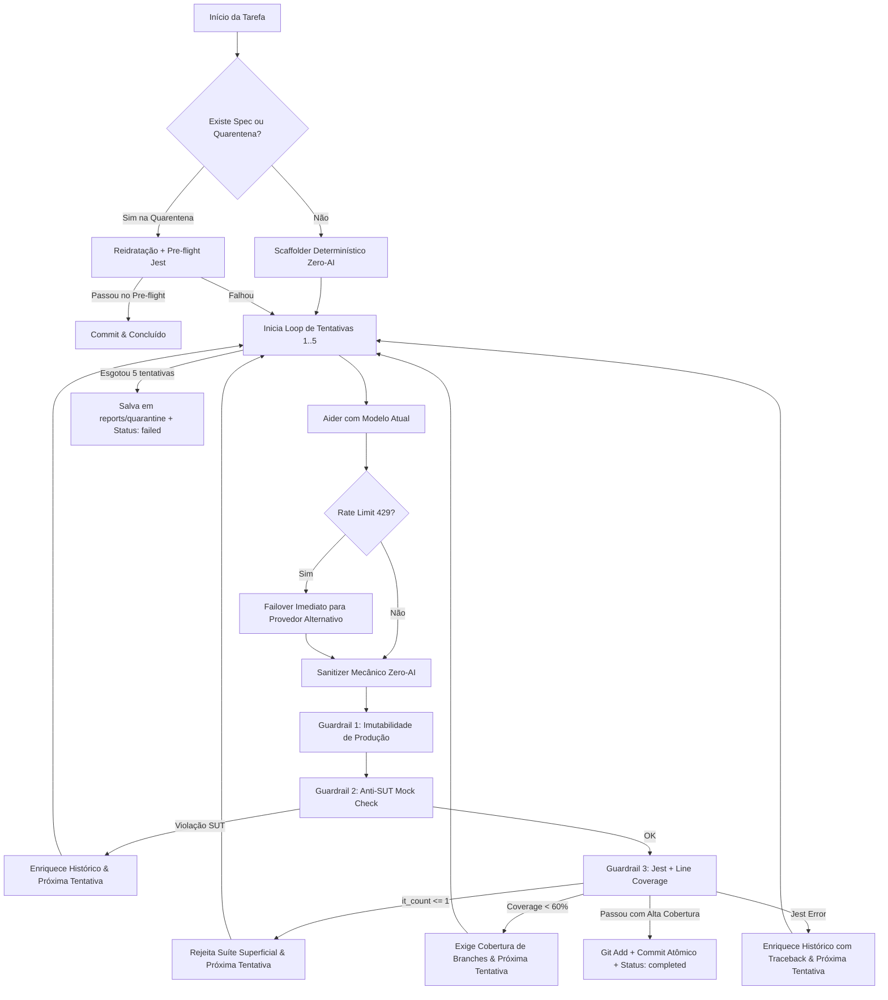

# AGENTS.md — Autonomous AI Testing Pipeline (`ai-pipeline`)

Este documento é a fonte canônica de contexto, arquitetura e convenções do projeto `ai-pipeline` para agentes de IA operando no Antigravity.

---

## 1. Visão Geral do Projeto

O `ai-pipeline` é um orquestrador autônomo de garantia de qualidade e geração de testes unitários.
Ele opera externamente a projetos de software (como `tattoopop-api`), varrendo serviços não testados ou quebrados, gerando scaffolds determinísticos de teste com mocks seguros, refinando as suítes com LLMs (Groq, Gemini, Ollama) via Aider em modo headless, e validando tudo contra o test runner nativo (Jest) com barreiras de qualidade inegociáveis.

### Pilares Fundamentais
1. **Imutabilidade do Código de Produção (Anti-Cheat)**: Arquivos de produção (`*.service.ts`) são estritamente somente leitura. Modificações em código de produção são revertidas imediatamente via Git.
2. **Quality Gate Estrito**: Nenhum teste é aceito a menos que o Jest nativo execute com exit code 0 e atinja a meta mínima de cobertura (>= 60%).
3. **Isolamento de Branches**: Opera em branches temáticas locais (ex: `feat/ai-unit-tests-api`) sem push automático para remotos.
4. **Preservação e Quarentena**: Testes que não passam após o limite de tentativas (`max_attempts = 5`) são isolados em `reports/quarantine/<module>/<file>.spec.ts` para análise humana ou reidratação futura.

---

## 2. Estrutura do Repositório

```text
ai-pipeline/
├── main.py                     # CLI unificada (comandos: scan, run, audit, retry-failed, status)
├── queue.json                  # Fila persistente de tarefas e máquina de estados
├── pipeline/
│   ├── scaffolder.py           # Gerador determinístico de scaffolds (Zero-AI) com mocks TypeORM e métodos it()
│   ├── worker.py               # Motor de execução de tarefa única (Aider + Jest + Quality Gate + Auto-Healer)
│   ├── runner.py               # Orquestrador em lote (BatchRunner) e escritor de relatórios Markdown
│   ├── queue_manager.py        # Gerenciamento da fila queue.json (garantia de IDs únicos TASK-XXX)
│   ├── scanner.py              # Scanner AST de serviços e detecção de suítes ausentes/superficiais
│   ├── auditor.py              # Auditor estático de qualidade, cobertura JSON e ingestão SonarQube
│   └── profiles/               # Perfis de framework (NestJS, Flutter, Svelte)
├── templates/
│   └── nestjs_prompt.txt       # Template de prompt mecânico (regras negativas + matriz de cenários A, B, C, D)
├── reports/                    # Relatórios consolidados de execução (run_YYYYMMDD_HHMMSS.md)
│   └── quarantine/             # Specs que falharam as tentativas isoladas para inspeção/reidratação
└── tests/                      # Suíte de testes unitários do próprio pipeline
```

---

## 3. Comandos de Operação (CLI)

Todos os comandos devem ser executados a partir da raiz `/Users/redguy/Documents/AI Enabler/ai-pipeline`:

```bash
# 1. Escanear projeto alvo (todos os domínios ou por módulo específico)
python3 main.py scan --target /Users/redguy/TattooPop/tattoopop-api --domain all

# 2. Verificar estado atual da fila
python3 main.py status

# 3. Executar lote com log compacto (padrão - foca no progresso essencial e erros resumidos)
python3 main.py run --queue-file queue.json --model groq/openai/gpt-oss-120b --limit 10

# 4. Executar lote com log completo/detalhado (-v ou --log-level verbose - inclui prompt inteiro, histórico e full tracebacks)
python3 main.py run --queue-file queue.json --model groq/openai/gpt-oss-120b --limit 10 -v

# 5. Executar lote em modo silencioso/minimalista (--log-level quiet)
python3 main.py run --queue-file queue.json --model groq/openai/gpt-oss-120b --limit 10 --log-level quiet

# 6. Resetar tarefas que falharam de volta para pendente
python3 main.py retry-failed

# 7. Auditoria de qualidade com SonarQube ou Jest Coverage
python3 main.py audit --target /Users/redguy/TattooPop/tattoopop-api --limit 20
```

---

## 4. Máquina de Estados da Fila (`queue.json`)

Cada tarefa possui a seguinte estrutura:
```json
{
  "id": "TASK-051",
  "project_path": "/Users/redguy/TattooPop/tattoopop-api",
  "service_file": "src/modules/address/GetAddressByCep.service.ts",
  "spec_file": "src/modules/address/GetAddressByCep.service.spec.ts",
  "module_name": "address",
  "profile": "nestjs",
  "status": "pending | in_progress | completed | failed",
  "attempts": 0,
  "max_attempts": 5,
  "error_log": null,
  "created_at": "ISO-8601",
  "updated_at": "ISO-8601"
}
```

### Regras Críticas de Fila:
- **Unicidade de IDs**: O ID `TASK-XXX` deve ser estritamente único. O `QueueManager.add_tasks()` calcula o `max_id_num` para nunca colidir IDs.
- **Interrupções limpas**: Se um processo for interrompido, tarefas com status `in_progress` devem ser resetadas para `pending` antes do próximo run.

---

## 5. Ciclo de Vida do Worker (`TaskWorker.execute_task`)



---

## 6. Convenções de Prompts e Feedback Contínuo

1. **Prompt Base (`templates/nestjs_prompt.txt`)**:
   - É estritamente **mecânico e livre de floreios**.
   - Possui 4 seções: Regras Negativas Mandatórias, Matriz de Cenários (Happy Path, Branches `if/else`, Casos Limite, Sad Path), Guia Anti-Erros de TypeScript (TypeORM / Brackets), e Golden Template de referência.
   - Chaves de interpolação Python: use `{{` e `}}` para blocos de código TypeScript literais para não quebrar o `.format()`.
2. **Memória Cumulativa (`attempt_history`)**:
   - Cada falha da tentativa `N` é registrada em `attempt_history.append(...)`.
   - O prompt da tentativa `N+1` recebe o histórico completo para que o modelo saiba exatamente o que já tentou e não cometa os mesmos erros.
3. **Instruções Cirúrgicas**:
   - Em vez de stack traces inteiras gigantescas, o feedback foca na causa-raiz: faltou `as any`, mockou o SUT, ou deixou blocos `// TODO`.

---

## 7. Modelos Suportados e Provedores

- **Groq (Nuvem Gratuita de Alta Velocidade)**:
  - `groq/openai/gpt-oss-120b` (Padrão para raciocínio profundo e geração de fixtures)
  - `groq/qwen/qwen3.8-27b` (Alternativa rápida para serviços simples)
- **Google Gemini (Nuvem)**:
  - `gemini/gemini-2.5-flash` (Failover rápido)
  - `gemini/gemini-3.1-pro-preview` (Para raciocínio complexo quando cotas estiverem disponíveis)
- **Ollama (Local / Metal GPU no Mac)**:
  - `ollama/qwen2.5-coder:14b` (Execução 100% offline e privada)

---

## 8. Guia para Agentes de IA Contribuindo neste Código

- **Nunca edite arquivos de produção de projetos monitorados diretamente**. Toda validação deve acontecer através do runner do `ai-pipeline`.
- **Preserve os Guardrails**: Qualquer alteração em `worker.py` deve manter intactos os 3 guardrails (imutabilidade, anti-SUT mock e verificação do Jest).
- **Testes do Próprio Pipeline**: Antes de finalizar mudanças no `ai-pipeline`, execute:
  ```bash
  python3 -m py_compile pipeline/*.py main.py
  ```
